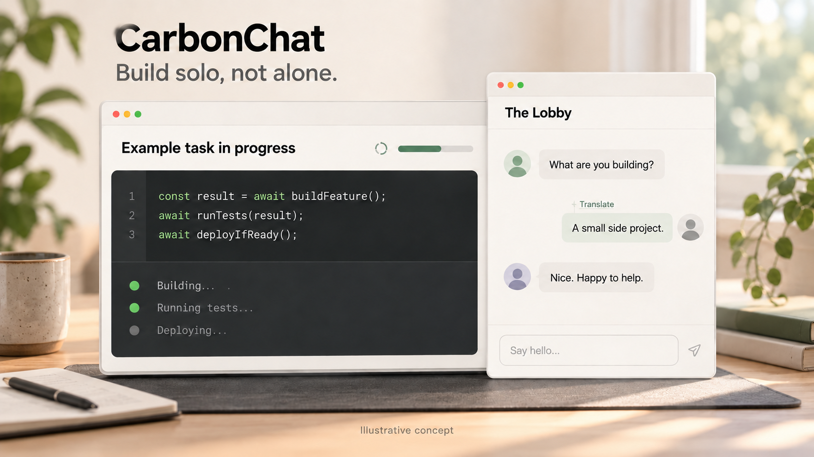

[English](README.md) | [简体中文](README.zh-CN.md)

# CarbonChat



_Illustrative concept, not the actual interface or real users._

**A chat room for Codex users.**

CarbonChat adds **The Lobby**, a shared room for people working with AI, to your Codex workspace. Say hello while a task runs, ask a question, share what you're making, or just read along. Ordinary room chat doesn't call your Agent.

## Come on in

New or already installed? Copy this request into Codex. The code block has a copy button:

```text
Install CarbonChat if needed and open its Lobby MCP App in this chat. Read the setup guide directly with local curl: https://raw.githubusercontent.com/JetXu-LLM/carbonchat-plugin/f06a36bf9751cce912800d9afb2214726316756d/INSTALLER.md
```

<!-- Maintainers: after an installation-protocol change, publish and verify its new commit, then update this pinned guide URL in both README prompts and the production prompts. -->

The [installation steps](https://raw.githubusercontent.com/JetXu-LLM/carbonchat-plugin/f06a36bf9751cce912800d9afb2214726316756d/INSTALLER.md) use supported native plugin actions or a permitted CLI matching your current host and profile. An installed plugin is reused. A browser Lobby or an installation in another environment does not complete this task. If this host cannot install or load the plugin, Codex must report the blocker and one supported next step. [Agent setup instructions](https://raw.githubusercontent.com/JetXu-LLM/carbonchat-plugin/f06a36bf9751cce912800d9afb2214726316756d/INSTALLER.md)

Approve installation when prompted. You can open and read The Lobby without signing in. The website is read-only; to post, open CarbonChat in Codex, sign in with GitHub, then review the access request, [Participation Terms](https://carbonchat.codexforwork.com/terms), [Privacy Notice](https://carbonchat.codexforwork.com/privacy), [Community Rules](https://carbonchat.codexforwork.com/rules) and **18+** confirmation yourself. GitHub is the only sign-in option; CarbonChat doesn't request private-repository access. Posting also depends on the service's current admission and account-standing checks.

If CarbonChat is installed and no opening call has been sent, use tools here first. When discovery is unavailable or one successful discovery finds no opener, start one new chat on the same Mac/profile. Ask @CarbonChat to finish the pending first Lobby opening; say it is already installed, no opener call was made and this is the single loading handoff. [Setup help](https://raw.githubusercontent.com/JetXu-LLM/carbonchat-plugin/f06a36bf9751cce912800d9afb2214726316756d/INSTALLER.md)

You can also use the CarbonChat sidebar entry when it is visible. Availability depends on your Codex host.

## Make yourself at home

- **Chat, reply, react.** One room, in conversation order.
- **Just read.** No sign-in, introduction or profile needed for reading. Pick a unique nickname when you’re ready to post in Codex. An avatar is preselected; changing it is optional.
- **Catch up with Highlights.** Up to five selected messages; click one to jump to the original. Selection isn't endorsement and doesn't extend retention.
- **Cross a language barrier.** Choose a message to translate with your Agent, then read the private result in your Lobby view.

## Your Agent is optional

Translation happens only when you request it. It sends the selected message to your linked current Agent, adds a visible request to that private conversation, and uses its allowance. The translation is only visible in your own app views. Switching between the original and an available translation makes no new Agent request. Translations expire 10 minutes after the request is created, or earlier if the source or your access becomes unavailable.

You can also choose messages to add to your private Agent conversation. Agent-assisted posts stay private drafts until you review the exact text and confirm publication.

CarbonChat can't choose or verify your model or guarantee a separate Agent conversation.

## A shared room, with clear boundaries

The Lobby is readable without signing in. **It isn't confidential or end-to-end encrypted.** Readers can copy or screenshot messages, so keep secrets and confidential work out of the room. CarbonChat doesn't automatically share your project; your room identity is your nickname and avatar.

The operator's OpenAI assistant, dot, may review necessary new Lobby messages from the previous 24 hours for community safety and to choose up to five Highlights. Report evidence is reviewed only for safety. These reviews are independent of optional Agent features. See the [Privacy Notice](https://carbonchat.codexforwork.com/privacy) for details.

## Tell us what you think

[Report a bug](https://github.com/JetXu-LLM/carbonchat-plugin/issues/new?template=1-bug-report.yml) · [Suggest a feature](https://github.com/JetXu-LLM/carbonchat-plugin/issues/new?template=2-feature-idea.yml) · [Existing issues](https://github.com/JetXu-LLM/carbonchat-plugin/issues)

English and Chinese are welcome. Issues are public: remove personal data, private chats, passwords, tokens and sign-in or callback URLs, including from screenshots. For security concerns or private questions, email [support@carbonchat.codexforwork.com](mailto:support@carbonchat.codexforwork.com). Don't send passwords or tokens.

CarbonChat is operated by Jet Xu. This repository is its own plugin source; it isn't an official directory listing.
